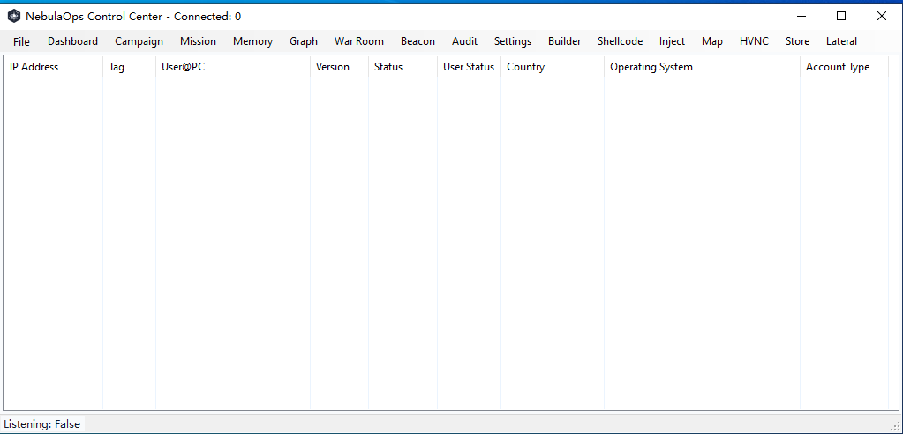
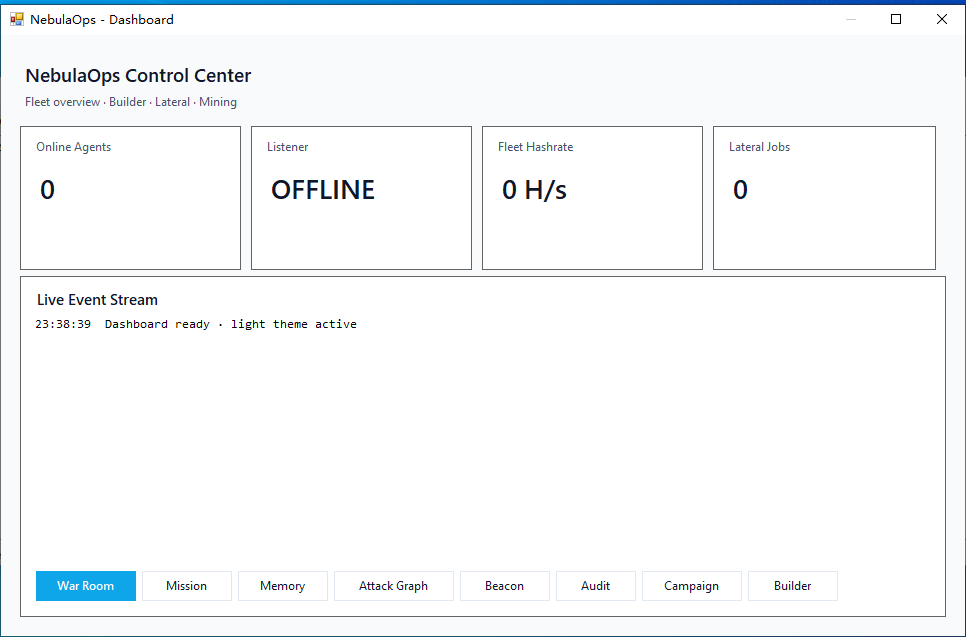
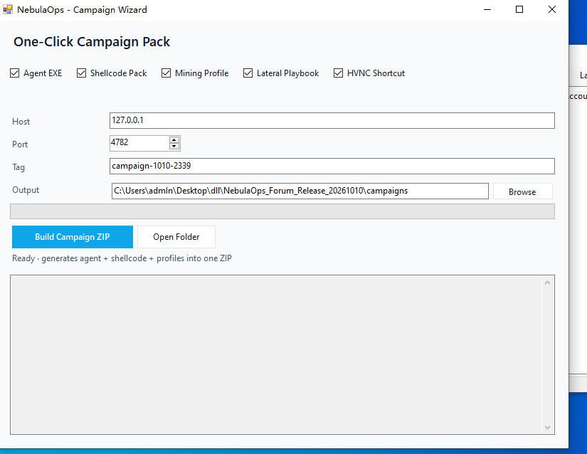
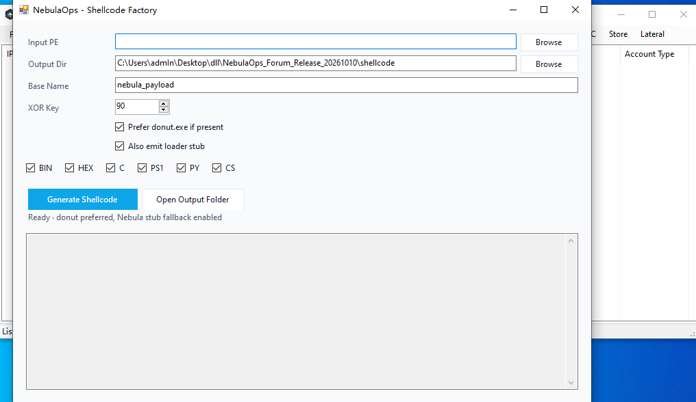
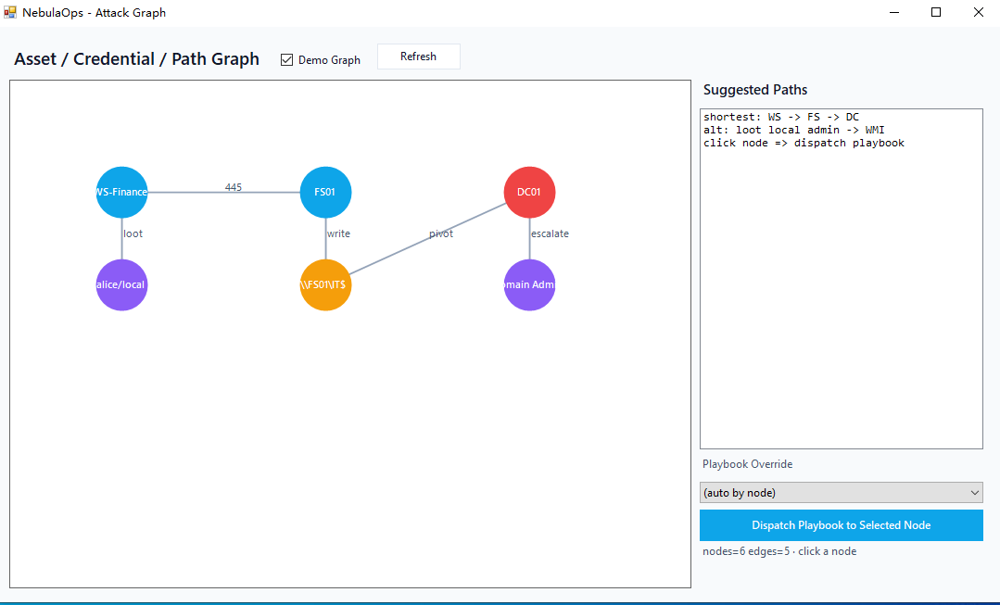
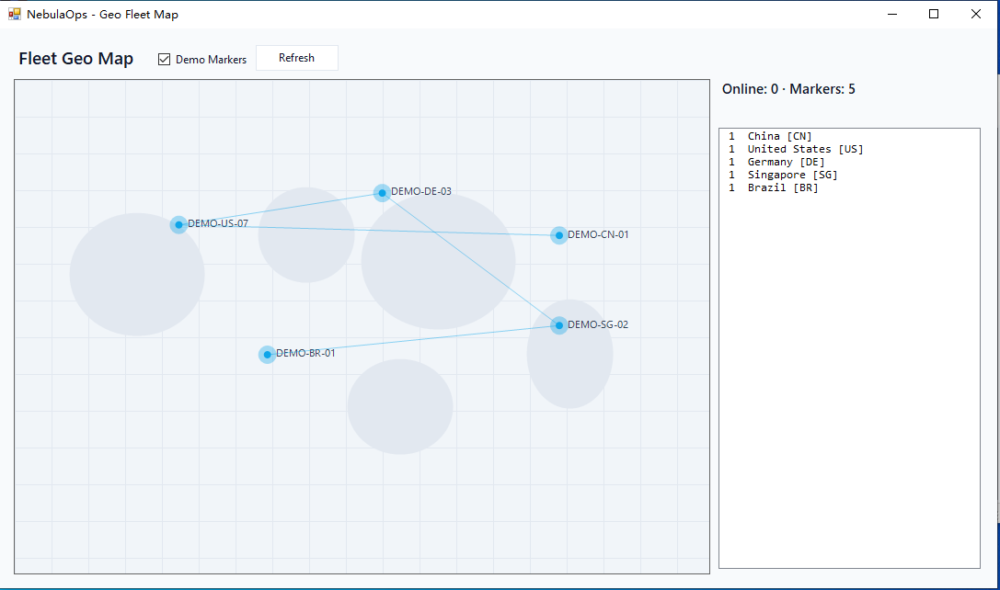

  

<h1 align="center">NebulaOps-RAT</h1>

  <b>Windows RAT / Red Team Command Platform</b> 
  <i>Research-oriented operator console for authorized adversary simulation</i>

  
  
  
  

---

## Search Keywords

`RAT` `Remote Access Trojan` `Windows RAT` `C2` `Red Team` `NebulaOps-RAT` `Adversary Simulation`

---

## What this repository is

This repository is the **public landing page** for NebulaOps-RAT:

- product overview
- screenshots
- feature documentation

It is intended for authorized red-team research, adversary-simulation labs, and security engineering demos.

> Runnable release packages are distributed through private / forum channels, not as a public malware drop.

---

## Highlights

- Light-theme Windows Control Center
- Builder with post-build evasion pipeline and score report
- Shellcode Factory + Injector + Memory Workbench
- Stealth Mining Console (hidden process / idle / CPU / watchdog / persist)
- Multi-channel Beacon Builder
- Campaign Wizard / Mission Scheduler / Attack Graph / Lateral Lab / HVNC

---

## Screenshots

### Control Center

### War Room

### Mission Scheduler

### Memory Tradecraft Workbench

### Attack Graph

### Beacon Builder

---

## Documentation

- [Full Feature Guide](docs/NebulaOps_Feature_Guide.md)
- [Feature Guide DOCX](docs/NebulaOps_Feature_Guide.docx)
- [Operator README](docs/README.txt)

---

## Capability Snapshot

| Area | Details |
|---|---|
| Evasion pipeline | junk methods, string noise, proxies, control-flow noise, anti-sandbox delay, overlay padding, metadata camouflage, score report |
| Memory tradecraft | AssemblyLoad / EarlyBirdAPC / Hollow / RemoteThread / LocalThread + OPSEC score |
| Stealth mining | camouflage process name, hidden window, idle-only, CPU cap, watchdog, persist, remote URL fetch |
| Beaconing | TCP-TLS / HTTPS-WS / Cloudflare / DoH / Telegram profiles |
| Ops surfaces | War Room, Mission Timeline, Attack Graph, Lateral Lab, HVNC |

---

## Responsible Use

NebulaOps-RAT is for:

- authorized red team engagements
- adversary simulation labs
- purple-team exercises
- security research and training

Use only on systems you own or are explicitly authorized to test.

---

  <b>NebulaOps-RAT / Nebula Labs</b> 
  Public research landing page

